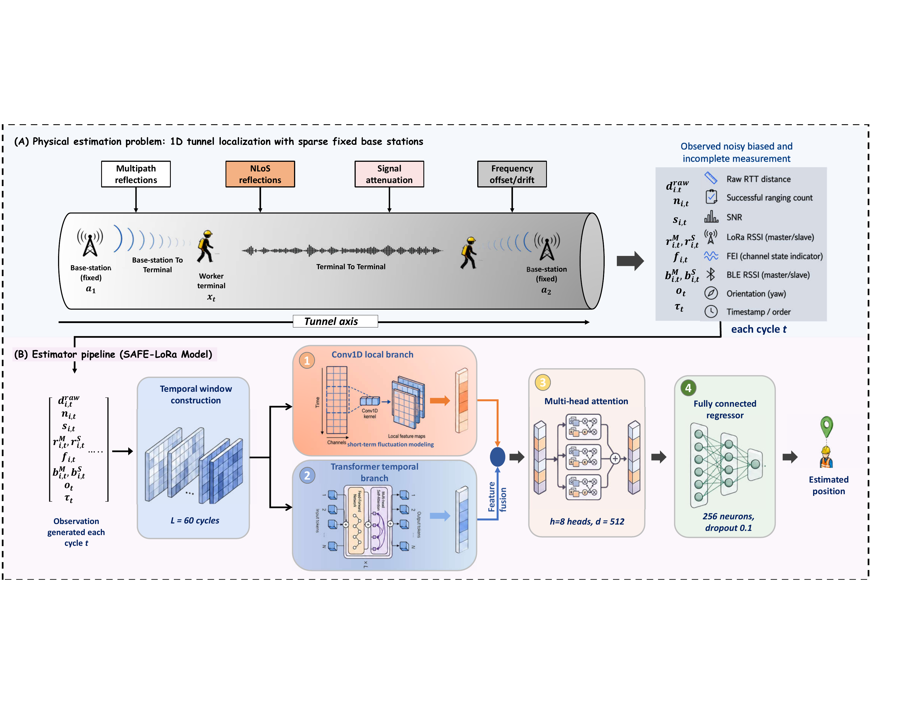
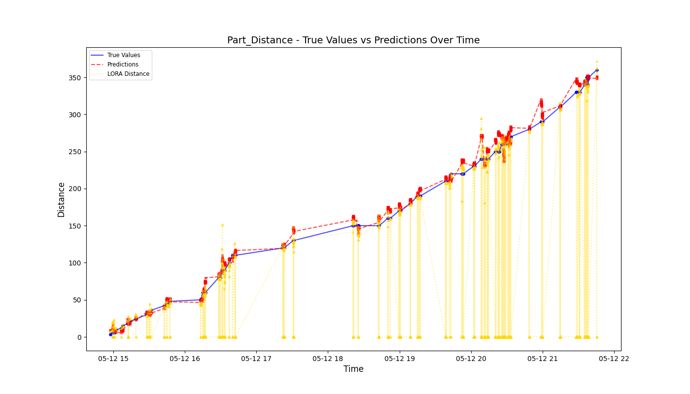
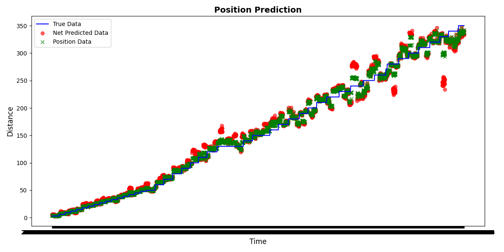
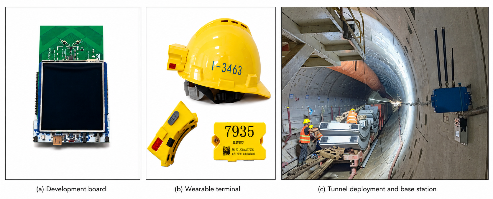

# SAFE

**SAFE: A Transformer-CNN Temporal Correction and Sparse-Anchor Fusion Estimator for Tunnel Personnel Localization**

[](https://www.ipccc.org/ipccc2026/)
[]()
[]()

This repository provides the experimental data and supporting material for **SAFE**, a practical LoRa-based personnel localization framework for active tunnel construction sites.

## Overview

Reliable personnel localization in tunnels is difficult because GNSS signals are unavailable, the environment is heavily occluded, and the work face changes continuously. Dense wireless infrastructure such as UWB and Wi-Fi is hard to install, relocate, and maintain in this setting.

SAFE addresses the problem as a deployment-constrained, longitudinal state-estimation task. It uses SX1302 LoRa round-trip time-of-flight (RTToF) ranging and four correction components:

1. **Conv1D** — extracts short-term ranging-error patterns
2. **Transformer encoder** — models temporal continuity across consecutive measurement cycles
3. **Multi-head attention** — refines interactions among distance and channel-state observations
4. **Fully connected regressor** — predicts the corrected anchor distance

Corrected distances from neighboring base stations are then combined through distance-dependent weighted fusion to estimate the worker's position along the tunnel axis.



## Key Results

| Metric | Raw LoRa | SAFE |
| --- | ---: | ---: |
| Single-anchor ranging MAE | 141.64 m | **7.34 m** |
| Two-anchor positioning MAE | 10.60 m | **7.48 m** |
| Mean end-to-end latency | — | **0.977 s** |
| Base-station spacing | — | up to **700 m** |
| Estimated capacity | — | above **200 workers** |

SAFE outperforms the Kalman filter and LSTM baselines, and ablation experiments confirm the contribution of each key module.

## Experimental Visuals

| Ranging correction | Multi-anchor fusion |
| --- | --- |
|  |  |



## Repository Contents

| File | Description |
| --- | --- |
| `Data samples V1.0.xlsx` | Initial ranging data samples |
| `Data samples V2.0.xlsx` | Updated ranging data samples with ground truth |
| `Parameters test V1.0.xlsx` | LoRa parameter test results |
| `Parameters test V1.2.xlsx` | Updated parameter test results |
| `Power consumption test.xlsx` | Terminal power consumption measurements |
| `Multi stations data samples and basic analysis.pdf` | Multi-base-station data and analysis |
| `assets/` | Figures used in this README |

## Data Use

The files are provided for academic reference, result verification, and further research on LoRa-based personnel positioning. Researchers may use the data to understand the experimental setup, reproduce selected analyses, or compare future methods with the reported results.

## Citation

If you use this repository in your research, please cite:

```bibtex
@inproceedings{zhao2026safe,
  title     = {SAFE: A Transformer-CNN Temporal Correction and Sparse-Anchor
               Fusion Estimator for Tunnel Personnel Localization},
  author    = {Zhengang Zhao and Xiaoyu Zhou and Jianfang Zhai and Yunus Isah
               and Wenbing Huang},
  booktitle = {Proceedings of the IEEE International Performance, Computing,
               and Communications Conference (IPCCC)},
  year      = {2026}
}
```

## License

This repository is provided for academic and research use only. Please contact the authors before using the data for commercial purposes.

## Contact

- Email: yunuxx@outlook.com
- Code and data: [github.com/Yunuxtech/SAFE](https://github.com/Yunuxtech/SAFE)

For questions, please contact the corresponding author or open an issue in this repository.
